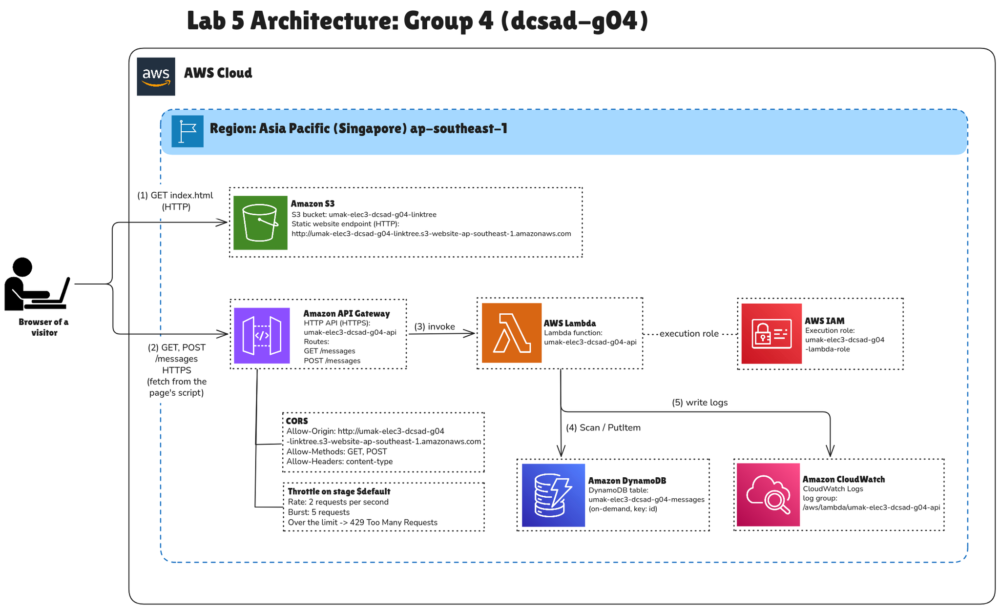

# Assignment 5 Submission

## About us

- Group number: 04
- Section: IV - DCSAD
- Group IAM user: dcsad-g04

## Diagram

## Estimate

Asia Pacific (Singapore), one month: 100,000 page views and 5,000 posts.

| Service            | Settings                                                                                             | Monthly cost (USD) |
| ------------------ | ---------------------------------------------------------------------------------------------------- | ------------------ |
| Amazon S3          | S3 Standard, 1 GB, 100,000 GET requests                                                              | 0.07               |
| Amazon API Gateway | HTTP API, 0.105 million requests, 1 KB each                                                          | 0.13               |
| AWS Lambda         | Without Free Tier, x86, 105,000 requests, 100 ms, 128 MB                                             | 0.04               |
| Amazon DynamoDB    | On-demand, Standard, 1 GB, 1 KB items, 0.005 million writes, 0.1 million eventually consistent reads | 0.29               |
| **Total**          |                                                                                                      | 0.53               |

Share link of our estimate: https://calculator.aws/#/estimate?id=bffa94bab4bb4137744cb2df463dffcedbfd35d9

## Ten times the traffic

With 1,000,000 page views and 50,000 posts a month, which service's monthly cost grows the most in US dollars, and why?

Amazon API Gateway grows the most in US dollars, increasing from $0.13 to $1.30 (an increase of +$1.17 per month).

At 10x traffic, storage remains constant at 1 GB while request-driven costs scale by 10x. Amazon API Gateway has no fixed storage fee, meaning 100% of its $0.13 baseline comes from the 0.105 million HTTP API requests; multiplying requests by 10 scales its entire cost linearly to $1.30 (+$1.17). 

By comparison, AWS Lambda has no fixed storage fee and scales from $0.04 to $0.40 (+$0.36). Amazon S3 keeps its fixed 1 GB storage cost at around $0.03 while its 100,000 GET requests scale by 10x to around $0.42, bringing its new total to an estimated $0.45 (+$0.38).

Finally, almost all of Amazon DynamoDB's $0.29 baseline comes from fixed 1 GB storage (~$0.285/month) and less than $0.01 comes from requests, so scaling requests by 10x only raises its total to about $0.35 (+$0.06). Because API Gateway has the highest per-request rate among the four services and zero fixed storage overhead, a 10x traffic increase produces the largest price jump (+$1.17).

## The throttle and one more improvement

Which Well-Architected pillar does the throttle on the `$default` stage serve, and why?

The throttle serves the Reliability pillar. It limits how many requests can reach the backend, so a sudden flood of visitors, bots, or a faulty script can’t overload the Lambda function and the database. Extra requests are turned away at the front door, which keeps the site working for real users. It also helps with cost, because rejected requests never run the function, so there is no charge for them.

One more improvement for the same architecture, and the pillar that it serves:

Place Amazon CloudFront in front of the Amazon S3 bucket hosting `index.html`, which serves the Performance Efficiency pillar. CloudFront caches the static page at edge locations closer to users worldwide, reducing network latency and speeding up page load times, while also lowering direct S3 `GET` request volume for Cost Optimization.

## Contribution

| GitHub username       | What this groupmate did                                                                                                                                                                              |
| --------------------- | ---------------------------------------------------------------------------------------------------------------------------------------------------------------------------------------------------- |
| CharlesTogle          | Task 1: Drew the Lab 5 architecture diagram.                                                                                                                                                         |
| vivrelavie            | Task 2: Built the AWS Pricing Calculator estimate for Asia Pacific (Singapore) with all four services (S3, API Gateway, Lambda, DynamoDB), filled in the estimate table, and created the share link. |
| JoaquinLuisGuevarra96 | Task 3: Worked out the ten-times-traffic costs from the estimate and explanation for the monthly cost.                                                                                               |
| AJPSJ                 | Task 4: Wrote the Well-Architected pillar answers and improvement.                                                                                                                                   |
