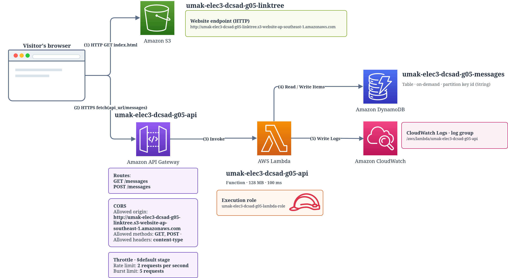

# Assignment 5 Submission

<!--
How to use this template:

1. Copy this file to submissions/assignment-5/group-<number>/submission.md
2. Replace every <answer> with your group's answer. Delete the angle brackets too.
3. Save diagram.png in the same folder.
4. Keep your invoke URL, your API ID, every ARN, and the account number out of this folder.
5. Write GitHub usernames, not full names or student numbers.
-->

## About us

- Group number: 05
- Section: IV-DCSAD
- Group IAM user: dcsad-g05

## Diagram

## Estimate

Asia Pacific (Singapore), one month: 100,000 page views and 5,000 posts.

| Service            | Settings                                                                                             | Monthly cost (USD) |
| ------------------ | ---------------------------------------------------------------------------------------------------- | ------------------ |
| Amazon S3          | S3 Standard, 1 GB, 100,000 GET requests                                                              | 0.07               |
| Amazon API Gateway | HTTP API, 0.105 million requests, 1 KB each                                                          | 0.13               |
| AWS Lambda         | Without Free Tier, x86, 105,000 requests, 100 ms, 128 MB                                             | 0.04               |
| Amazon DynamoDB    | On-demand, Standard, 1 GB, 1 KB items, 0.005 million writes, 0.1 million eventually consistent reads | 0.29               |
| **Total**          |                                                                                                      | 0.53               |

Share link of our estimate: [https://calculator.aws/#/estimate?id=9f840b03b95cfb88c39d77b6d6d1d015581c2581](https://calculator.aws/#/estimate?id=9f840b03b95cfb88c39d77b6d6d1d015581c2581)

## Ten times the traffic

With 1,000,000 page views and 50,000 posts a month, which service's monthly cost grows the most in US dollars, and why?

**Amazon API Gateway** grows the most. It has no fixed cost, so its whole $0.13 comes from requests: 0.105 million at $1.25 per million. Ten times the traffic (1.05 million requests) costs about $1.31, so it grows by about $1.18. Lambda has no fixed cost either and goes from $0.04 to about $0.43 (+$0.39). S3 keeps its 1 GB of storage at about $0.03 while its 100,000 GET requests grow to 1,000,000, so it goes from $0.07 to about $0.43 (+$0.36). DynamoDB grows least: almost all of its $0.29 is the fixed 1 GB of storage (about $0.285), so ten times the reads and writes only raise it to about $0.39 (+$0.10). API Gateway still charges the most per request, so the same tenfold traffic adds the most dollars there.

## The throttle and one more improvement

Which Well-Architected pillar does the throttle on the `$default` stage serve, and why?

The **Reliability** pillar. The throttle caps how fast requests reach our API, so a flood cannot exhaust Lambda or DynamoDB and take the site down for real visitors; requests over the limit get a `429` and never run the function.

One more improvement for the same architecture, and the pillar that it serves:

Put **Amazon CloudFront** in front of the bucket with Origin Access Control, serve the site over **HTTPS**, and turn Block Public Access back on. Pillar: **Security**, because the traffic is encrypted and the bucket is no longer public. The CORS allowed origin becomes the CloudFront domain.

## Contribution

| GitHub username | What this groupmate did |
| --- | --- |
| TrishchanJimenez | Drew the Lab 5 architecture diagram |
| jjcabalo | Configured the S3, API Gateway, Lambda, and DynamoDB entries in the estimate |
| scaoile | Checked every calculator field and verified the share link |
| JoeyRVisayaJr | Answered the two questions and completed submission.md |
