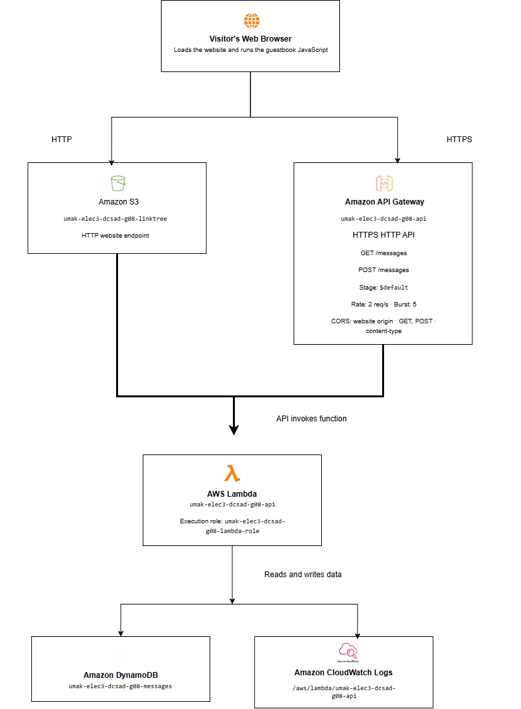

# Assignment 5 Submission

<!--
How to use this template:

1. Copy this file to submissions/assignment-5/group-<number>/submission.md
2. Replace every <answer> with your group's answer. Delete the angle brackets too.
3. Save diagram.png in the same folder.
4. Keep your invoke URL, your API ID, every ARN, and the account number out of this folder.
5. Write GitHub usernames, not full names or student numbers.
-->

## About us

- Group number: Group 8
- Section: IV - DCSAD
- Group IAM user: dcsad-g08

## Diagram



## Estimate

Asia Pacific (Singapore), one month: 100,000 page views and 5,000 posts.

| Service | Settings | Monthly cost (USD) |
| --- | --- | --- |
| Amazon S3 | S3 Standard, 1 GB, 100,000 GET requests | 0.07 USD |
| Amazon API Gateway | HTTP API, 0.105 million requests, 1 KB each | 0.13 USD |
| AWS Lambda | Without Free Tier, x86, 105,000 requests, 100 ms, 128 MB | 0.04 USD |
| Amazon DynamoDB | On-demand, Standard, 1 GB, 1 KB items, 0.005 million writes, 0.1 million eventually consistent reads | 30.12 USD |
| **Total** | | **30.36 USD** |

Share link of our estimate: https://calculator.aws/#/estimate?id=4be582cf3d1c23325a8604433da848728f0a0265

## Ten times the traffic

With 1,000,000 page views and 50,000 posts a month, which service's monthly cost grows the most in US dollars, and why?

```
Amazon API Gateway is expected to have the largest increase in monthly cost in US dollars. The number of HTTP API requests increases from 105,000 to 1,050,000 per month. Since API Gateway charges based on the number of requests, the additional 945,000 requests result in a higher monthly cost. Therefore, API Gateway has the greatest expected cost increase among the services under the given traffic assumptions.
```

## The throttle and one more improvement

Which Well-Architected pillar does the throttle on the `$default` stage serve, and why?

```
The throttle serves the Reliability pillar of the AWS Well-Architected Framework. By limiting API requests to 2 requests per second with a burst limit of 5, API Gateway helps prevent excessive traffic from overwhelming the backend. Requests that exceed the limit receive a 429 Too Many Requests response, helping protect the availability and stability of the application.
```

One more improvement for the same architecture, and the pillar that it serves:

```
One additional improvement is to configure Amazon CloudWatch alarms to monitor Lambda errors and throttling. This supports the Operational Excellence pillar because it helps the team monitor application performance, detect problems, and respond to operational issues more effectively.
```

## Contribution

| GitHub username | What this groupmate did |
| --- | --- |
| micmiccc16 | Created the architecture diagram. |
| jdyyy1 | Led the team, coordinated tasks, and finalized the submission. |
| shaeluh | Created the architecture diagram. |
| MarcoLasaga | Prepared the AWS cost estimates.Answered the analysis and Well-Architected questions. |