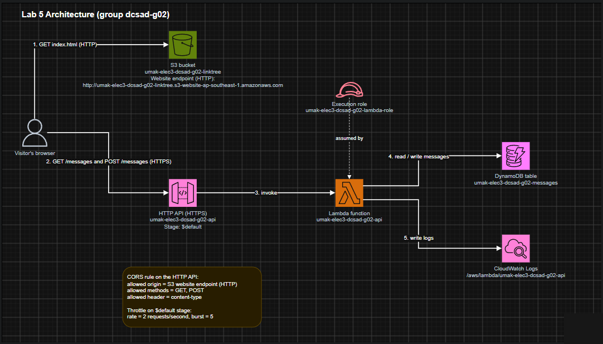

# Assignment 5 Submission

## About us

- Group number: 2
- Section: IV - DCSAD
- Group IAM user: dcsad-g02

## Diagram

## Estimate

Asia Pacific (Singapore), one month: 100,000 page views and 5,000 posts.

| Service | Settings | Monthly cost (USD) |
|---|---|---|
| Amazon S3 | S3 Standard, 1 GB, 100,000 GET requests | 0.07 |
| Amazon API Gateway | HTTP API, 0.105 million requests, 1 KB each | 0.13 |
| AWS Lambda | Without Free Tier, x86, 105,000 requests, 100 ms, 128 MB | 0.04 |
| Amazon DynamoDB | On-demand, Standard, 1 GB, 1 KB items, 0.005 million writes, 0.1 million eventually consistent reads | 0.29 |
| **Total** | | **0.53** |

Share link of our estimate: https://calculator.aws/#/estimate?id=a2d2869f45d593bbba2d5eb6b2a5c7212771c3d7

## Ten times the traffic

**Amazon API Gateway** grows the most. Its monthly cost jumps from 0.13 USD to 1.31 USD, about 1.18 USD more, while the others grow by less (S3 +0.35, Lambda +0.39, DynamoDB +0.10). That's because API Gateway charges for every request, about 1.25 USD per million, and every page visit and message goes through it. DynamoDB barely changes because most of its cost is just storing the 1 GB of data. In total, the monthly bill goes from 0.53 USD to 2.55 USD.

## The throttle and one more improvement

**Which pillar does the throttle serve?** Reliability. The throttle limits the site to 2 requests per second (burst 5) on the `$default` stage. If a sudden spike of traffic arrives, API Gateway rejects the extra requests with a 429 error before they reach Lambda and DynamoDB, so the backend doesn't get overloaded and the accepted requests still work normally.

**One more improvement:** Add a CloudWatch alarm on Lambda errors and API Gateway 429 responses that sends an email notification. Pillar: Operational Excellence, because the team learns about problems quickly instead of finding them later in the logs.

## Contribution

| GitHub username | What this groupmate did |
|---|---|
| mmanzanilloa12241800-sudo | Drew the diagram, priced the estimate, and wrote the answers |
| Zanis3 | Helped drew the diagram, helped priced the estimate |
| johnlenardtaligatos16 | Helped wrote the answers |
