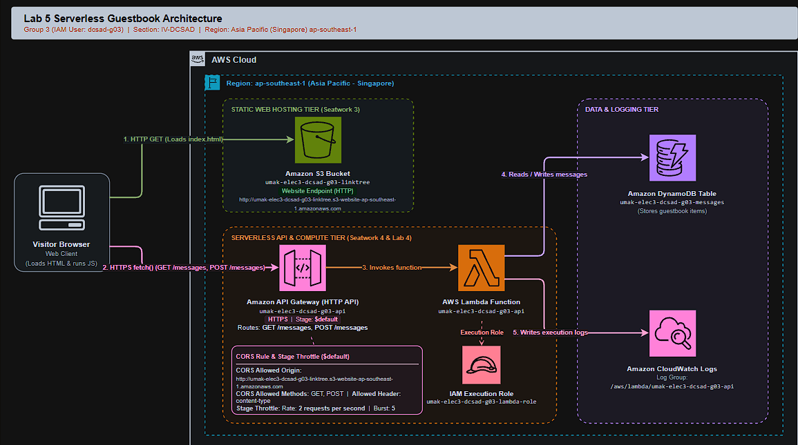

# Assignment 5 Submission

## About us

- Group number: 3
- Section: DCSAD
- Group IAM user: dcsad-g03

## Diagram

## Estimate

Asia Pacific (Singapore), one month: 100,000 page views and 5,000 posts.

| Service | Settings | Monthly cost (USD) |
| --- | --- | --- |
| Amazon S3 | S3 Standard, 1 GB, 100,000 GET requests | $0.07 |
| Amazon API Gateway | HTTP API, 0.105 million requests, 1 KB each | $0.13 |
| AWS Lambda | Without Free Tier, x86, 105,000 requests, 100 ms, 128 MB | $0.04 |
| Amazon DynamoDB | On-demand, Standard, 1 GB, 1 KB items, 0.005 million writes, 0.1 million eventually consistent reads | $0.03 |
| **Total** | | $0.27 |

Share link of our estimate: https://calculator.aws/#/estimate?id=4fe4e05ee2c753e8cb82e9d7877d36b1b5003068

## Ten times the traffic

With 1,000,000 page views and 50,000 posts a month, which service's monthly cost grows the most in US dollars, and why?

**Amazon API Gateway** grows the most in US dollars, increasing by **+$1.18** per month (from **$0.13** to **$1.31**).

In Asia Pacific (Singapore), HTTP API requests cost **$1.25 per million** with no fixed storage baseline. At 1× traffic (`0.105 million` requests = 100,000 `GET /messages` + 5,000 `POST /messages`), API Gateway costs `$0.13125` (**$0.13**). Scaling 10× to `1.05 million` requests multiplies that cost directly by 10 to `$1.3125` (**$1.31**), adding **+$1.18**. By comparison, **AWS Lambda** grows by **+$0.39** (from `$0.04` to `$0.43` for 1,050,000 runs), **Amazon S3** grows by **+$0.36** (from `$0.07` to `$0.43`, since 1 GB Standard storage stays fixed at `$0.025` while 1,000,000 GET requests cost `$0.40`), and **Amazon DynamoDB** grows by **+$0.26** (from `$0.03` to `$0.29`, since 1 GB storage remains `$0.00` under the 25 GB Always-Free allowance while 50,000 writes and 1,000,000 eventually consistent reads scale 10×).

## The throttle and one more improvement

Which Well-Architected pillar does the throttle on the `$default` stage serve, and why?

The throttle on the `$default` stage (rate: `2 requests per second`, burst: `5`) serves the **Reliability** pillar. It protects downstream serverless resources—specifically **AWS Lambda** concurrency and **Amazon DynamoDB** throughput—from sudden traffic spikes, accidental infinite client loops, or request floods. By rejecting excess requests at the API Gateway edge with `429 Too Many Requests` before Lambda runs, it prevents resource exhaustion and cascading failures so the guestbook remains available for normal visitors.

One more improvement for the same architecture, and the pillar that it serves:

Place **Amazon CloudFront** in front of the Amazon S3 website endpoint (`umak-elec3-dcsad-g03-linktree`) to serve `index.html` over **HTTPS** with Origin Access Control (OAC) and edge caching. This serves the **Security** pillar by encrypting frontend traffic in transit with TLS and eliminating direct public HTTP access to the S3 bucket (while also improving **Performance Efficiency** through edge caching).

## Contribution

| GitHub username | What this groupmate did |
| --- | --- |
| @Vinjin2705 | Drew the Lab 5 architecture diagram (`diagram.png`) with official AWS Architecture Icons, built the AWS Pricing Calculator estimate and share link, prepared `submission.md`, and submitted the Pull Request and Google Form for the group. |
| @abulotano | Verified all Group 3 (`dcsad-g03`) resource names against `README.md`, audited the submission folder to ensure no invoke URLs, API IDs, ARNs, or account numbers were exposed, and verified the 10× traffic calculations. |
| @plngpc | Tested the public Pricing Calculator share link in a private browser session and reviewed the AWS Well-Architected Framework pillar justifications. |