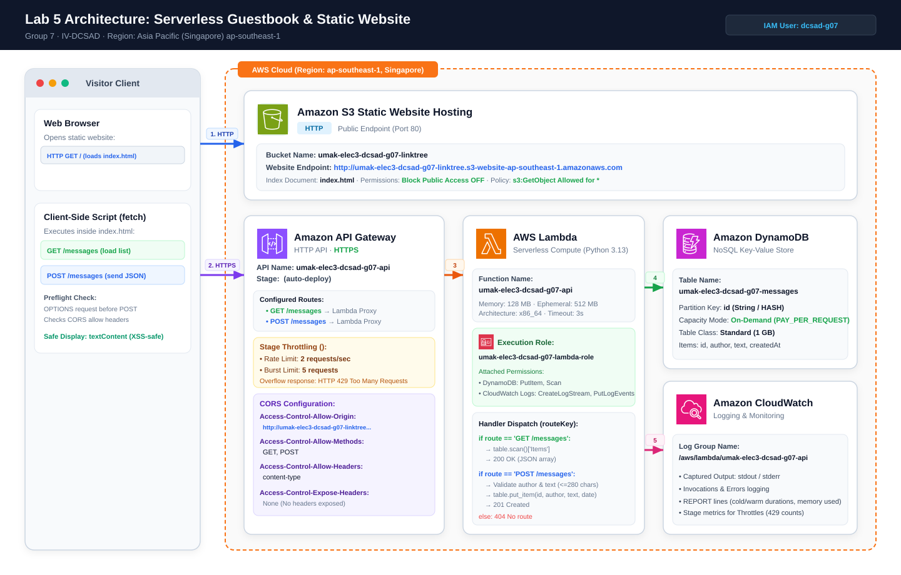

# Assignment 5 Submission

<!--
How to use this template:

1. Copy this file to submissions/assignment-5/group-<number>/submission.md
2. Replace every <answer> with your group's answer. Delete the angle brackets too.
3. Save diagram.png in the same folder.
4. Keep your invoke URL, your API ID, every ARN, and the account number out of this folder.
5. Write GitHub usernames, not full names or student numbers.
-->

## About us

- Group number: 7
- Section: IV-DCSAD
- Group IAM user: dcsad-g07

## Diagram

## Estimate

Asia Pacific (Singapore), one month: 100,000 page views and 5,000 posts.

| Service | Settings | Monthly cost (USD) |
| --- | --- | --- |
| Amazon S3 | S3 Standard, 1 GB, 100,000 GET requests | 0.07 |
| Amazon API Gateway | HTTP API, 0.105 million requests, 1 KB each | 0.13 |
| AWS Lambda | Without Free Tier, x86, 105,000 requests, 100 ms, 128 MB | 0.04 |
| Amazon DynamoDB | On-demand, Standard, 1 GB, 1 KB items, 0.005 million writes, 0.1 million eventually consistent reads | 0.29 |
| **Total** | | 0.53 |

Share link of our estimate: https://calculator.aws/#/estimate?id=2608afd191a78d361622b744cf20a774a49f1c45

## Ten times the traffic

With 1,000,000 page views and 50,000 posts a month, which service's monthly cost grows the most in US dollars, and why?

**Amazon API Gateway** grows the most in US dollars. At $1.29 per million requests in Singapore, scaling from 0.105 million requests to 1.05 million requests increases its monthly bill by approximately **$1.21 USD** (from $0.13 to $1.34). In comparison, S3 GET requests only increase by ~$0.40 USD (from $0.044 to $0.44), Lambda compute with 128 MB / 100 ms only increases by ~$0.39 USD, and DynamoDB read/write request units only increase by ~$0.21 USD. Therefore, API Gateway incurs the highest dollar cost growth.

## The throttle and one more improvement

Which Well-Architected pillar does the throttle on the `$default` stage serve, and why?

The throttle serves the **Reliability** pillar (as well as **Cost Optimization**). By limiting request throughput to a rate of 2 requests per second and a burst of 5 requests, it protects downstream AWS Lambda concurrency and DynamoDB read/write capacity from being overwhelmed by traffic spikes or denial-of-service attempts. This safeguards the application against cascading failures, ensuring service stability while preventing runaway invocation costs.

One more improvement for the same architecture, and the pillar that it serves:

Deploy **Amazon CloudFront** as a global Content Delivery Network (CDN) in front of the Amazon S3 website endpoint. This serves the **Performance Efficiency** (and **Security**) pillar by caching static HTML, CSS, and asset files at Edge Locations physically closer to visitors, significantly reducing latency and server response times while offloading traffic from S3 and providing automatic DDoS mitigation.

## Contribution

| GitHub username | What this groupmate did |
| --- | --- |
| TroyMichaelCamarillo | Modeled AWS Lambda and API Gateway cost parameters and configured architecture diagram |
| ichannnj | Configured Amazon S3 and DynamoDB estimates in AWS Pricing Calculator and generated share link |
| CPCNarido | Analyzed 10x traffic cost growth comparison across services |
| Motea47 | Formulated Well-Architected Framework evaluation and CloudFront improvement proposal |
