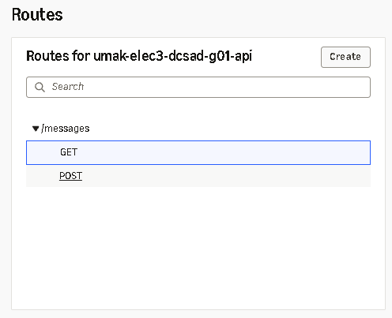
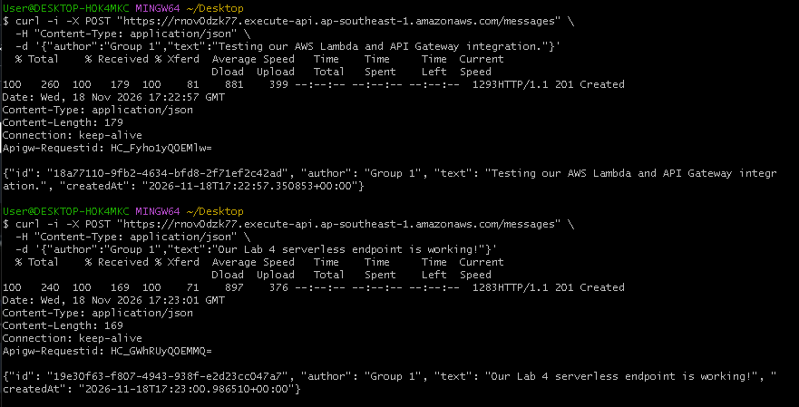
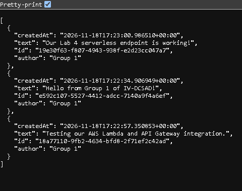
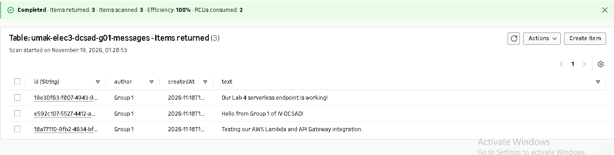

# Lab 4 Submission

## About us

- Group number: Group 1
- Section: IV-DCSAD
- Group IAM user: `dcsad-g01`
- DynamoDB table name: `umak-elec3-dcsad-g01-messages`
- HTTP API name: `umak-elec3-dcsad-g01-api`

## Handler code

```python
import base64
import json
import uuid
from datetime import datetime, timezone

import boto3

GROUP_NAME = "Group 1 of IV-DCSAD"
TABLE_NAME = "umak-elec3-dcsad-g01-messages"

dynamodb = boto3.resource("dynamodb")
table = dynamodb.Table(TABLE_NAME)


def response(status_code, body):
    return {
        "statusCode": status_code,
        "headers": {
            "Content-Type": "application/json"
        },
        "body": json.dumps(body)
    }


def lambda_handler(event, context):
    route_key = event.get("routeKey", "")

    if route_key == "GET /messages":
        result = table.scan()
        return response(200, result.get("Items", []))

    elif route_key == "POST /messages":
        body = event.get("body") or "{}"

        if event.get("isBase64Encoded", False):
            body = base64.b64decode(body).decode("utf-8")

        try:
            data = json.loads(body)
        except (json.JSONDecodeError, TypeError):
            return response(400, {"error": "Invalid JSON body"})

        text = data.get("text", "")

        if not isinstance(text, str) or not text.strip():
            return response(400, {"error": "Message text is required"})

        if len(text) > 280:
            return response(400, {"error": "Message must not exceed 280 characters"})

        message = {
            "id": str(uuid.uuid4()),
            "author": data.get("author") or GROUP_NAME,
            "text": text,
            "createdAt": datetime.now(timezone.utc).isoformat()
        }

        table.put_item(Item=message)

        return response(201, message)

    return response(404, {"error": "Not Found"})
```

## Screenshots









## Questions

**1. Both routes call the same function. How does your code know which route a request came through?**

The Lambda function checks the `routeKey` property in the API Gateway event. It identifies whether the request came from `GET /messages` or `POST /messages` and executes the corresponding code.

**2. What answer do you get when you open the invoke URL without `/messages`? Why does API Gateway answer this way, and not your function?**

The response is `{"message":"Not Found"}`. API Gateway returns this response because there is no route configured for the root path `/`. The request does not match any configured route, so it is not forwarded to the Lambda function.

**3. Your `GET /messages` route uses Scan. What happens to the cost of each GET request as the table grows to thousands of messages? Why?**

The cost of each GET request increases as the table grows because DynamoDB Scan reads through the table's items to retrieve the messages. Larger tables require more read capacity and processing time. Scan operations can also require pagination when the results exceed the 1 MB response limit. For larger applications, Query with an appropriate partition key is generally more efficient.
