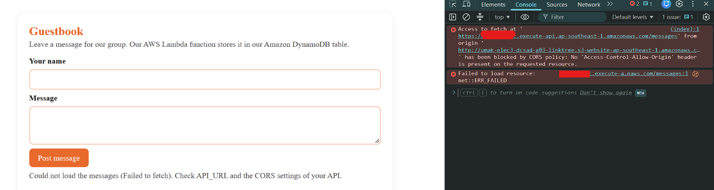
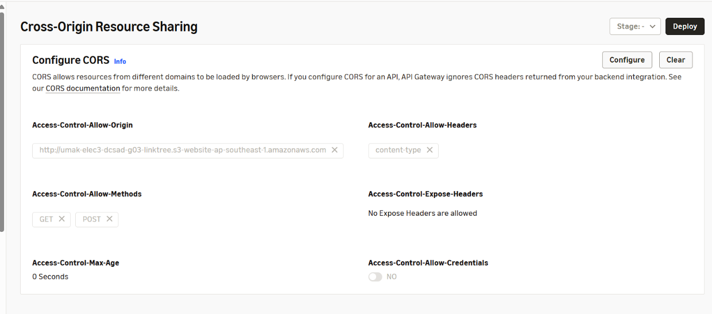
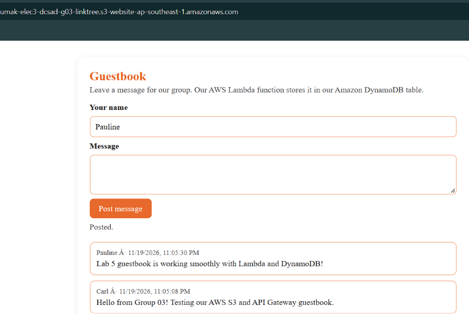
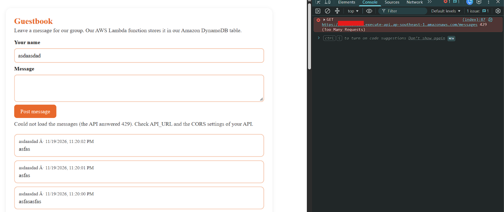

# Lab 5 Submission

## About us

- Group number: 03
- Section: DCSAD
- Group IAM user: dcsad-g03
- Website endpoint: http://umak-elec3-dcsad-g03-linktree.s3-website-ap-southeast-1.amazonaws.com
- HTTP API name: umak-elec3-dcsad-g03-api

## Screenshots

## Questions

1. In Lab 4, your API answered `curl` and the address bar of your browser. In Step 3, the same API did not answer your page. Why?

   `curl` and direct browser address bar navigation make top-level requests, so browsers do not enforce Cross-Origin Resource Sharing (CORS) restrictions on them. In Step 3, JavaScript `fetch()` on our S3 static website (`http://umak-elec3-dcsad-g03-linktree.s3-website-ap-southeast-1.amazonaws.com`) made a cross-origin request to a different domain (`execute-api.ap-southeast-1.amazonaws.com`), and because CORS was not yet configured on API Gateway, the response lacked the required `Access-Control-Allow-Origin` header and was blocked by the browser's Same-Origin Policy.

2. Which pillar of the AWS Well-Architected Framework does your throttle serve? Explain in two sentences.

   Throttling serves the Reliability pillar of the AWS Well-Architected Framework. By limiting the request rate and burst capacity at the API Gateway stage, it prevents sudden traffic spikes or abuse from overwhelming our downstream Lambda function and DynamoDB table, keeping the service available for legitimate users.

3. Your guestbook shows each message with `textContent`. What could a visitor do if the page put each message into the page as HTML with `innerHTML`?

   If the guestbook used `innerHTML` instead of `textContent`, a visitor could perform a Stored Cross-Site Scripting (XSS) attack by submitting malicious HTML or JavaScript (such as `` or `<script>` payloads) as their name or message. Whenever any other visitor loads the page, the browser would parse and execute that injected code in their session, allowing the attacker to deface the website, redirect users, or steal sensitive browser data.
EOF