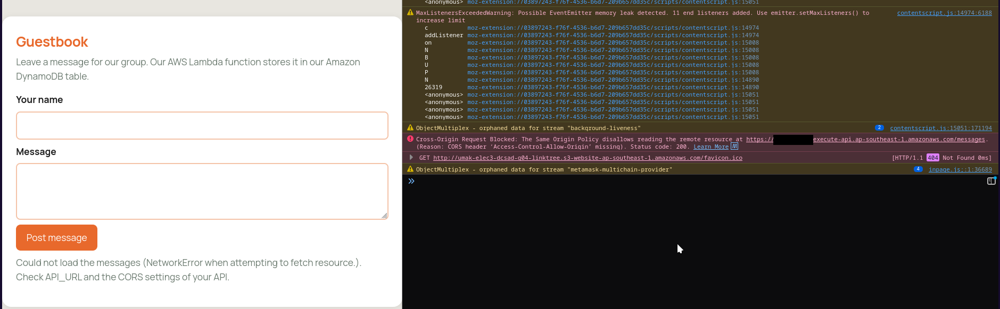
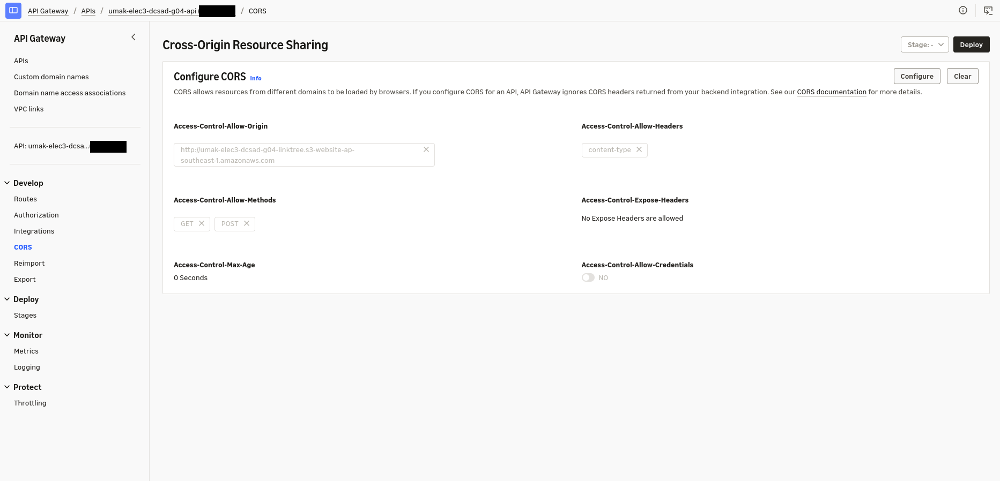
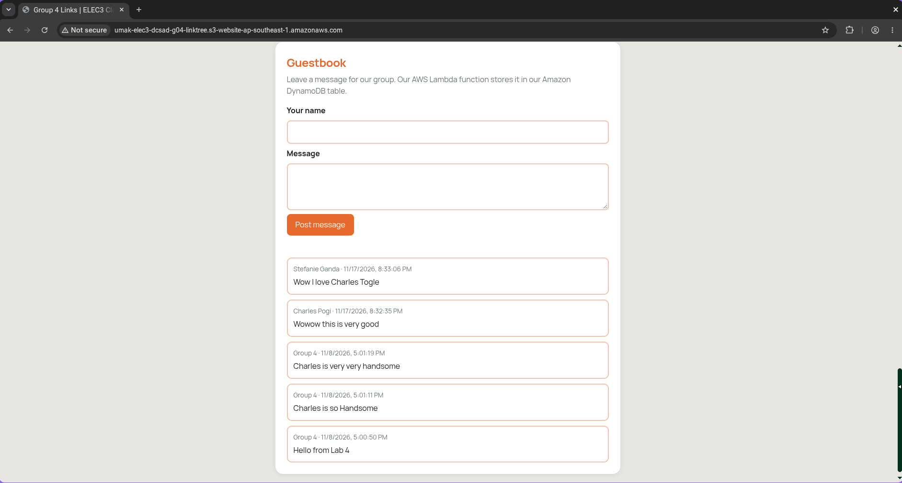
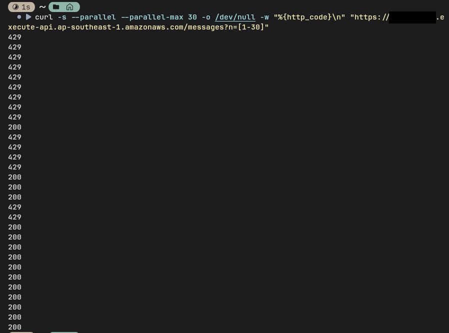

# Lab 5 Submission

## About us

- Group number: 4
- Section: IV-DCSAD
- Group IAM user: dcsad-g04
- Website endpoint: http://umak-elec3-dcsad-g04-linktree.s3-website-ap-southeast-1.amazonaws.com
- HTTP API name: umak-elec3-dcsad-g04-api 

## Screenshots

## Questions

1. In Lab 4, your API answered `curl` and the address bar of your browser. In Step 3, the same API did not answer your page. Why?

	Both curl and our page called the same API through API Gateway, and the API answered both. The difference is that our page's fetch runs in the browser, and the browser enforces CORS: our page and API are on different origins, and the API sent no Access-Control-Allow-Origin header, so the browser blocked the page from reading the answer. curl and the address bar are direct calls that don't enforce CORS, so they showed the answer.

2. Which pillar of the AWS Well-Architected Framework does your throttle serve? Explain in two sentences.

	The throttle serves the Reliability pillar, because it caps requests at 2 per second (with a burst of 5) so a flood of traffic to our public URL can't overwhelm the Lambda function or DynamoDB table. Extra requests are turned away with a 429 Too Many Requests before the function runs, which keeps the API available for normal visitors at no cost for the refused requests.

3. Your guestbook shows each message with `textContent`. What could a visitor do if the page put each message into the page as HTML with `innerHTML`?

	If the guestbook used innerHTML, a visitor could post a message containing HTML with hidden JavaScript. The browser would treat it as real code and run it instead of just displaying it. 
	
	Since the message is saved in our DynamoDB table, that script would run in the browser of everyone who opens the page. This is called stored cross-site scripting (XSS). An attacker could use it to deface the page, redirect visitors to another site, show a fake form to steal what people type, or call our API to post spam as them. 
	
	With textContent, the message is shown as plain text, so the same input appears as harmless characters and never runs.
