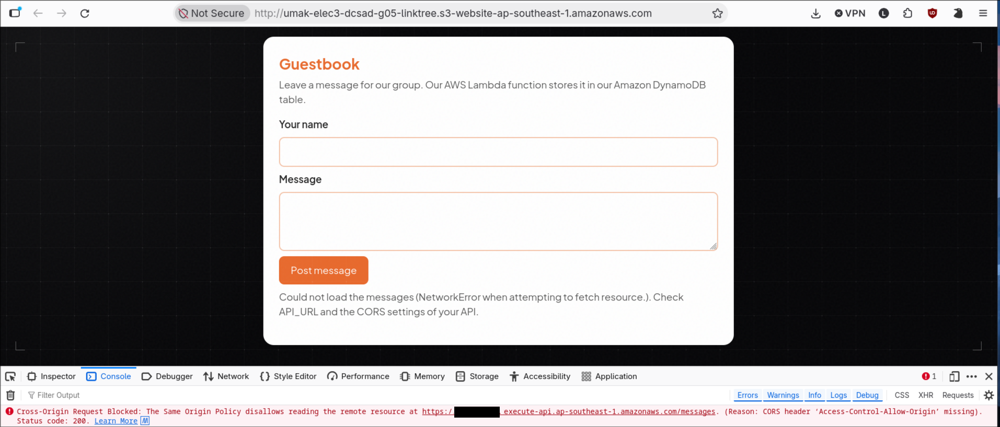
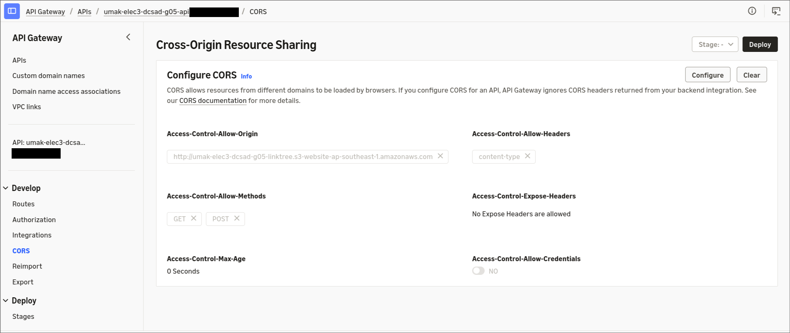
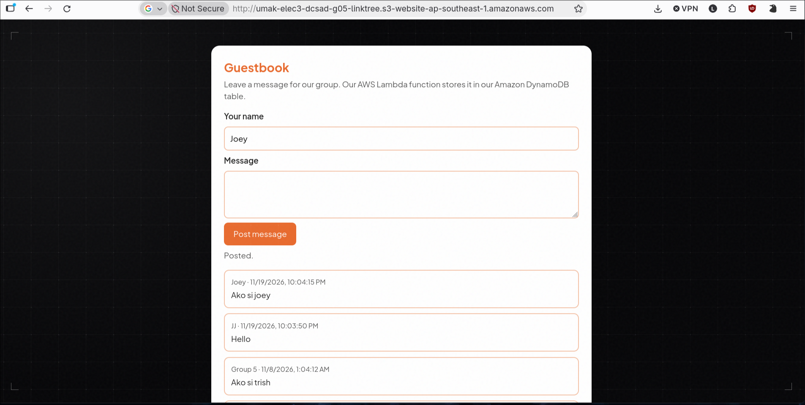
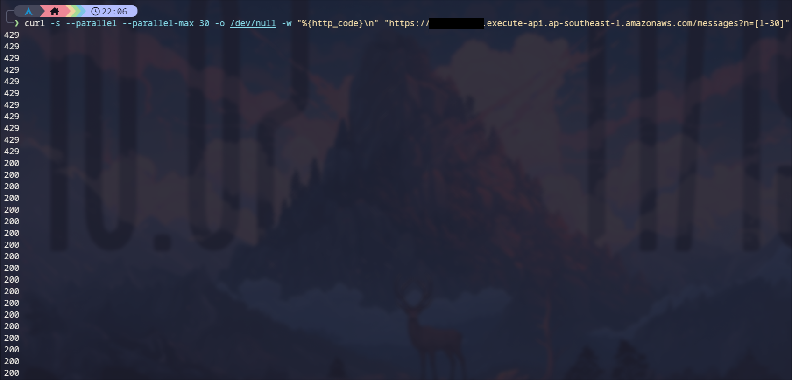

# Lab 5 Submission

## About us

- Group number: 05
- Section: IV-DCSAD
- Group IAM user: dcsad-g05
- Website endpoint: http://umak-elec3-dcsad-g05-linktree.s3-website-ap-southeast-1.amazonaws.com
- HTTP API name: umak-elec3-dcsad-g05-api

## Screenshots

## Questions

1. In Lab 4, your API answered `curl` and the address bar of your browser. In Step 3, the same API did not answer your page. Why?

   CORS is enforced by the browser on page scripts, not by the API. `curl` and the address bar are not page scripts, so no CORS check happens. Our page fetched a different origin, and the response had no `Access-Control-Allow-Origin` header for our site, so the browser blocked it.

2. Which pillar of the AWS Well-Architected Framework does your throttle serve? Explain in two sentences.

   The **Reliability** pillar. The throttle caps how many requests reach our API, so a flood or runaway client cannot exhaust Lambda concurrency or DynamoDB and take the guestbook down; excess requests get `429 Too Many Requests` without running the function, so the endpoint stays available under load.

3. Your guestbook shows each message with `textContent`. What could a visitor do if the page put each message into the page as HTML with `innerHTML`?

   With `innerHTML`, messages are parsed as HTML, so a visitor could post JavaScript like `` and it would run for everyone who opens the guestbook (stored cross-site scripting), letting them steal data, act as visitors, or deface the page. `textContent` shows the message as inert text, so nothing runs.
