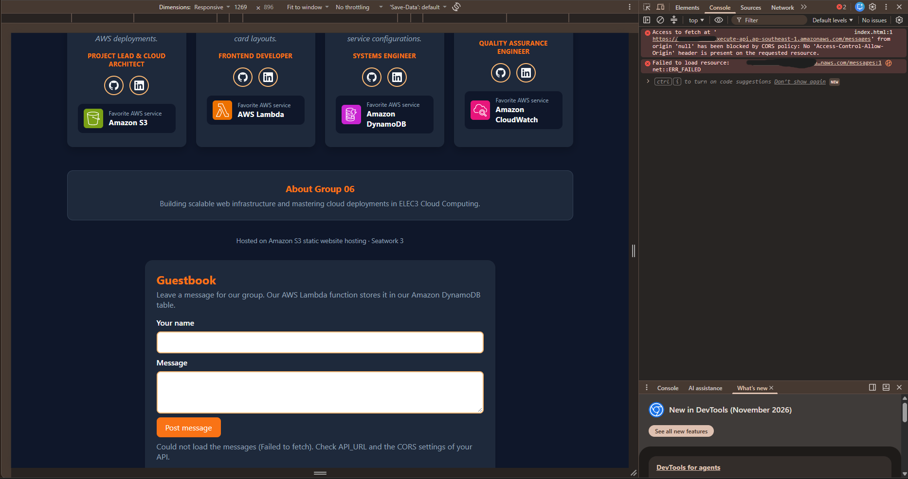
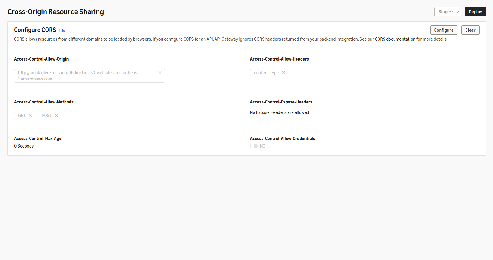
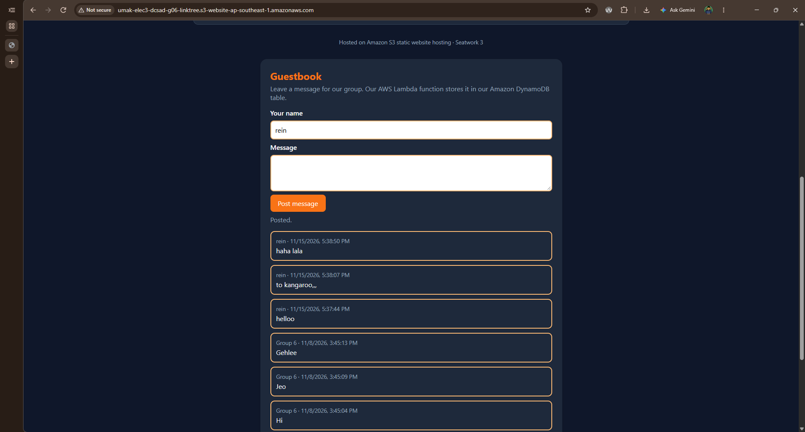
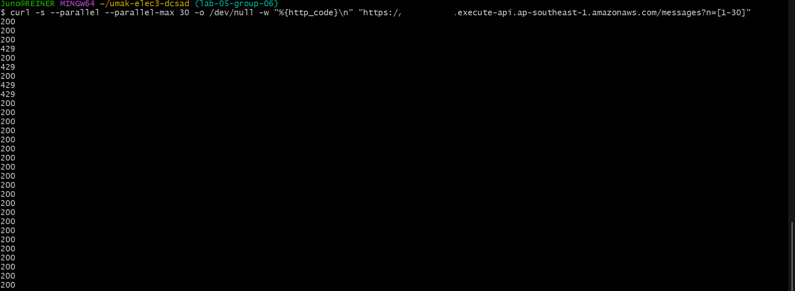

# Lab 5 Submission

## About us

- Group number: Group 06
- Section: IV-DCSAD
- Group IAM user: dcsad-g06
- Website endpoint: http://umak-elec3-dcsad-g06-linktree.s3-website-ap-southeast-1.amazonaws.com
- HTTP API name: umak-elec3-dcsad-g06-api

## Screenshots

## Questions

1. In Lab 4, your API answered `curl` and the address bar of your browser. In Step 3, the same API did not answer your page. Why?

   CORS (Cross-Origin Resource Sharing) is a browser security rule that only restricts JavaScript requests made from one web origin (`http://umak-elec3-dcsad-g06-linktree.s3-website-ap-southeast-1.amazonaws.com`) to another origin (`https://<API-ID>.execute-api.ap-southeast-1.amazonaws.com`). Because `curl` and typing a URL directly into the browser address bar are not scripts running inside a web page, CORS does not apply to them, whereas our guestbook's `fetch` script was blocked by the browser until our API explicitly returned the `Access-Control-Allow-Origin` header.

2. Which pillar of the AWS Well-Architected Framework does your throttle serve? Explain in two sentences.

   The stage throttle serves the **Reliability** pillar of the AWS Well-Architected Framework. By limiting traffic to 2 requests per second with a burst of 5 requests and returning `429 Too Many Requests` when exceeded, it protects our Lambda function and DynamoDB table from being overwhelmed by sudden traffic spikes or abuse so the application stays available for legitimate visitors.

3. Your guestbook shows each message with `textContent`. What could a visitor do if the page put each message into the page as HTML with `innerHTML`?

   If the page rendered messages using `innerHTML`, a visitor could perform a Cross-Site Scripting (XSS) attack by submitting malicious HTML or `<script>` tags in the guestbook form. That injected JavaScript would then automatically execute in the browser of every future visitor who loads the page, allowing the attacker to deface the website, redirect users, or steal sensitive browser data.