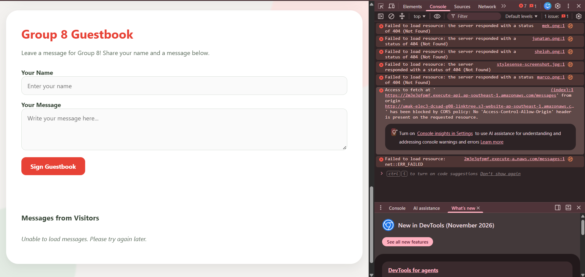
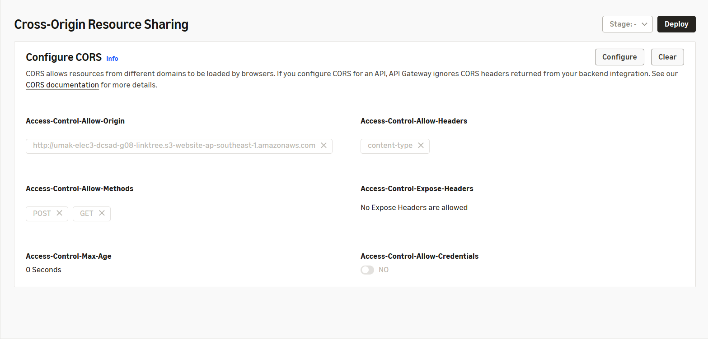
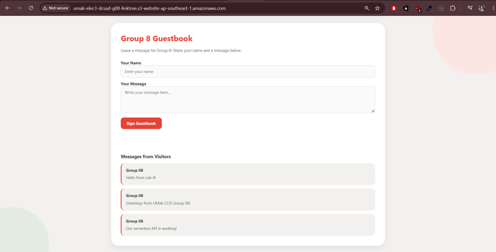
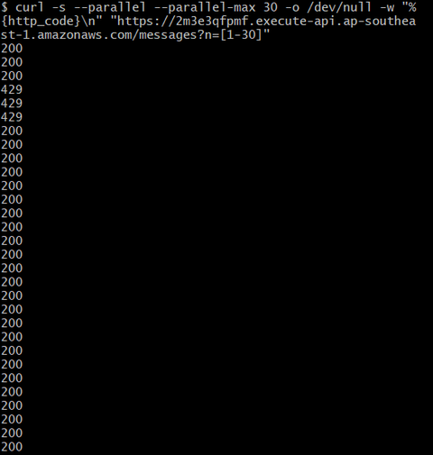

# Lab 5 Submission

<!--
How to use this template:

1. Copy this file to submissions/lab-5/group-<number>/submission.md
2. Replace every <answer> with your group's answer. Delete the angle brackets too.
3. Save cors-error.png, cors.png, site.png, and throttle.png in the same folder.
4. Crop the AWS console top bar out of cors.png, and cover every ARN.
5. Cover your API ID, the part between https:// and .execute-api, in cors-error.png, cors.png, and throttle.png.
6. Do not add your index.html. It holds your invoke URL.
7. Do not write full names or student numbers in this file.
-->

## About us

- Group number: Group 8
- Section: IV - DCSAD
- Group IAM user: dcsad-g08
- Website endpoint: http://umak-elec3-dcsad-g08-linktree.s3-website-ap-southeast-1.amazonaws.com
- HTTP API name: umak-elec3-dcsad-g08-api

## Screenshots


`cors-error.png`


`cors.png`


`site.png`


`throttle.png`


## Questions

1. In Lab 4, your API answered `curl` and the address bar of your browser. In Step 3, the same API did not answer your page. Why?

   ```
   The API was working, but the browser blocked the JavaScript request because the website and API had different origins. The API had not yet been configured with CORS to allow requests from our S3 website, so the browser would not let the page read the API response. curl and directly opening the API URL are not subject to this browser restriction.
   ```

2. Which pillar of the AWS Well-Architected Framework does your throttle serve? Explain in two sentences.

   ```
   The throttle primarily supports the Reliability pillar because it helps protect the API and its backend resources from excessive request traffic. By limiting requests, it reduces the risk of overloading the Lambda function and helps keep the application available for normal users.
   ```

3. Your guestbook shows each message with `textContent`. What could a visitor do if the page put each message into the page as HTML with `innerHTML`?

   ```
   A visitor could submit malicious HTML or JavaScript as a message, potentially causing a cross-site scripting (XSS) attack. This could execute unwanted scripts in other visitors' browsers, potentially stealing information or performing actions without their permission.
   ```
