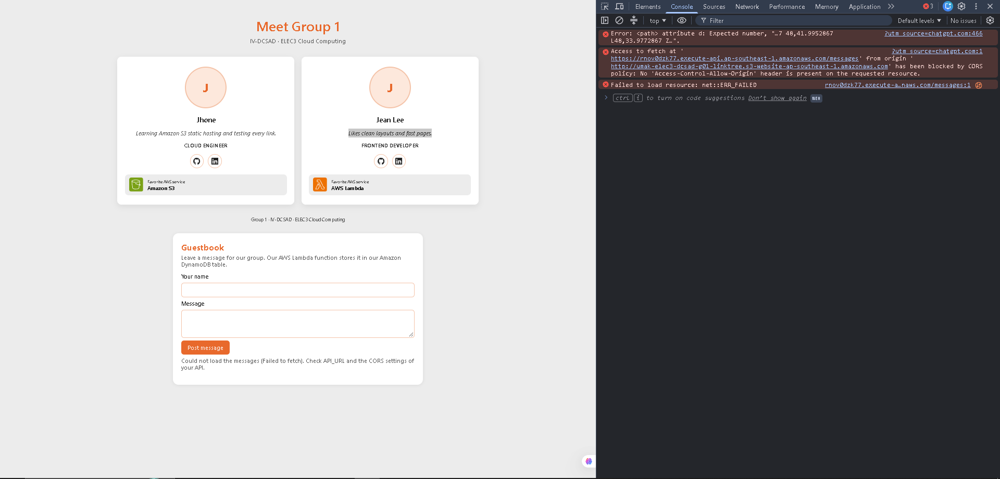
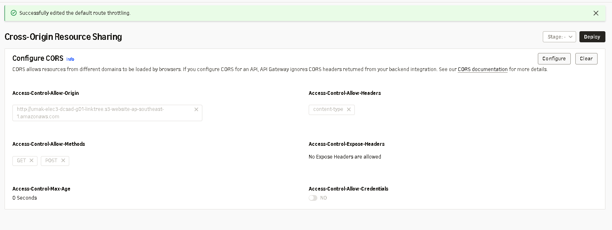
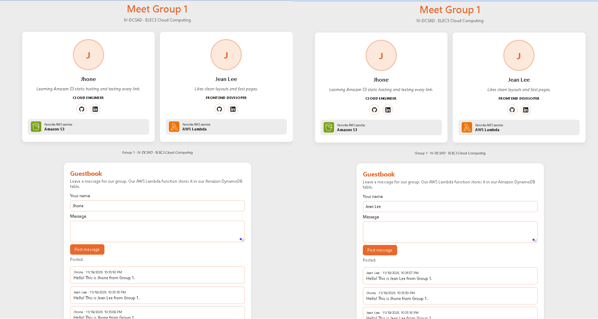
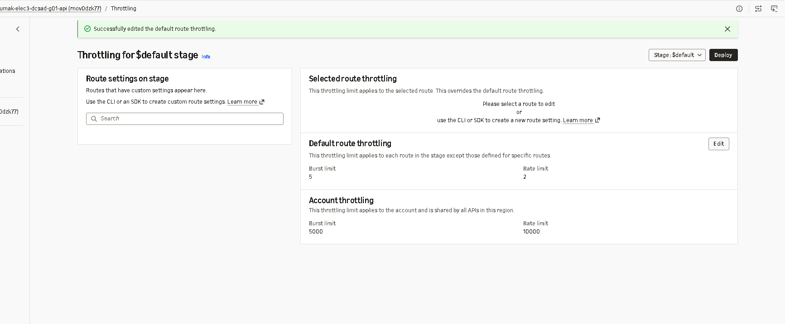

# Lab 5 Submission

## About us

- Group number: 1
- Section: IV-DCSAD
- Group IAM user: dcsad-g01
- Website endpoint: http://umak-elec3-dcsad-g01-linktree.s3-website-ap-southeast-1.amazonaws.com
- HTTP API name: umak-elec3-dcsad-g01-api

## Screenshots

## Questions

1. In Lab 4, your API answered `curl` and the address bar of your browser. In Step 3, the same API did not answer your page. Why?

   CORS is a browser security rule that controls whether a web page can access resources from another origin. The `curl` command and browser address bar worked because they are not scripts running on a web page, but our Guestbook uses JavaScript `fetch()` to access the API, which requires the API to allow our website's origin.

2. Which pillar of the AWS Well-Architected Framework does your throttle serve? Explain in two sentences.

   The throttle serves the Reliability pillar of the AWS Well-Architected Framework. It helps prevent the API from being overloaded by limiting incoming requests, allowing the service to remain available and handle requests more reliably.

3. Your guestbook shows each message with `textContent`. What could a visitor do if the page put each message into the page as HTML with `innerHTML`?

   A visitor could submit malicious HTML or JavaScript code as a guestbook message. If the page uses `innerHTML`, the browser could interpret and execute that code, potentially causing a cross-site scripting (XSS) attack.
