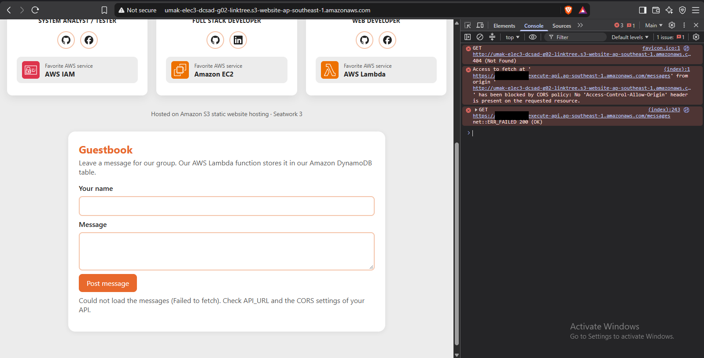
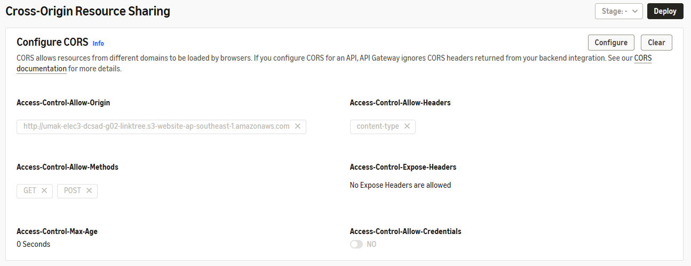
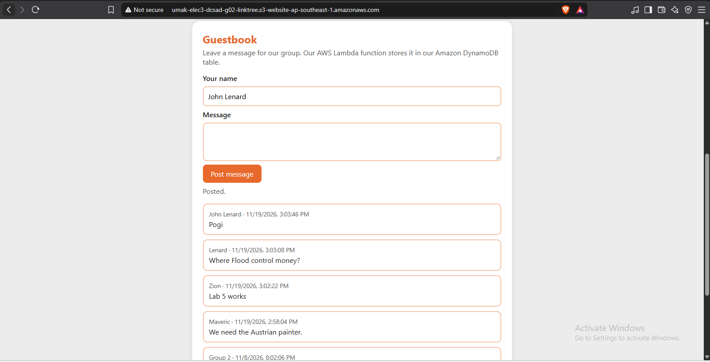
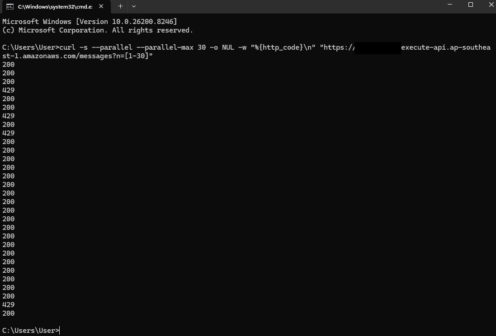

# Lab 5 Submission

## About us

- Group number: 2
- Section: IV-DCSAD
- Group IAM user: dcsad-g02
- Website endpoint: http://umak-elec3-dcsad-g02-linktree.s3-website-ap-southeast-1.amazonaws.com
- HTTP API name: umak-elec3-dcsad-g02-api

## Screenshots

## Questions

1. In Lab 4, your API answered `curl` and the address bar of your browser. In Step 3, the same API did not answer your page. Why?

   `curl` and the address bar are not scripts running on a web page, so the browser's CORS rule does not apply to them. In Step 3, the script on our S3 page
   (a different origin from the API) asked the API for data, but the API did not send an `Access-Control-Allow-Origin` header naming our site. The browser therefore
   blocked the script from reading the answer, even though the API itself responded.

3. Which pillar of the AWS Well-Architected Framework does your throttle serve? Explain in two sentences.

   The throttle serves the Reliability pillar. By limiting the API to 2 requests per second with a burst of 5, it stops a flood of requests from overloading the Lambda
   function and the DynamoDB table, so the guestbook keeps working for normal visitors.

5. Your guestbook shows each message with `textContent`. What could a visitor do if the page put each message into the page as HTML with `innerHTML`?

   A visitor could post a message that contains HTML or a script, for example an `` tag with an `onerror` handler. With `innerHTML`, the browser would run that
   code in every other visitor's browser when the page loads (cross-site scripting). It could steal data, redirect visitors, or deface the page. `textContent` shows the
   message as plain text, so no code runs.
