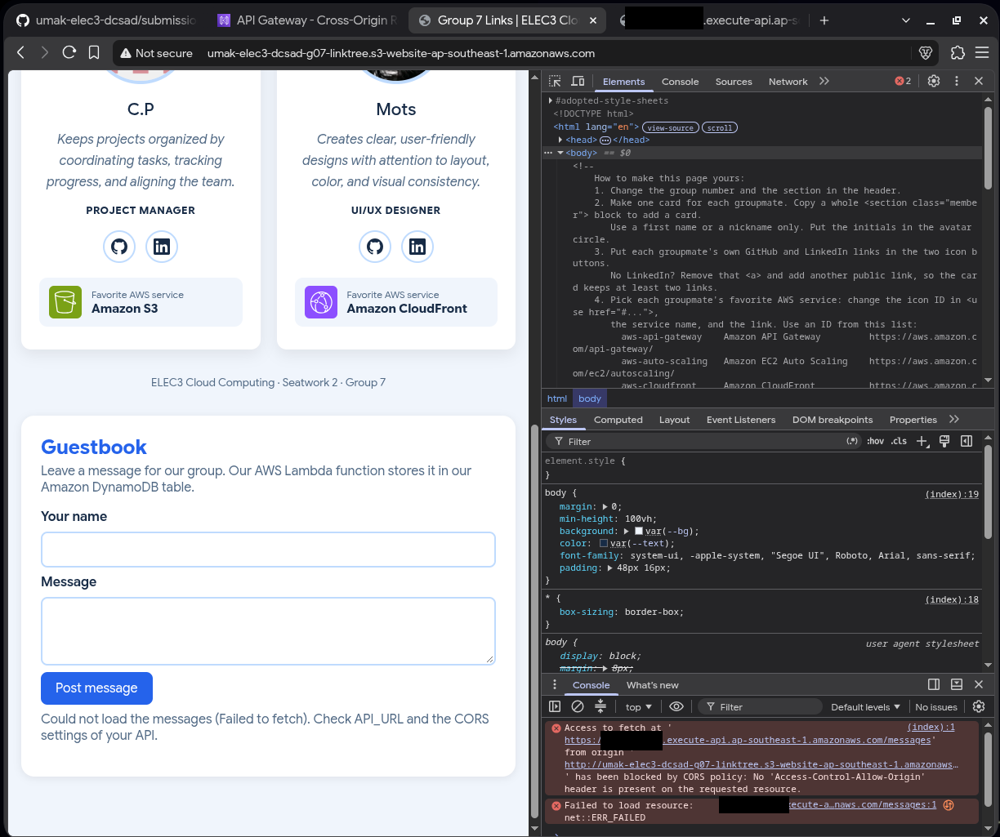
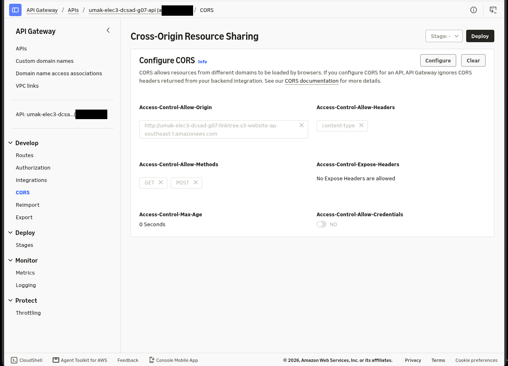
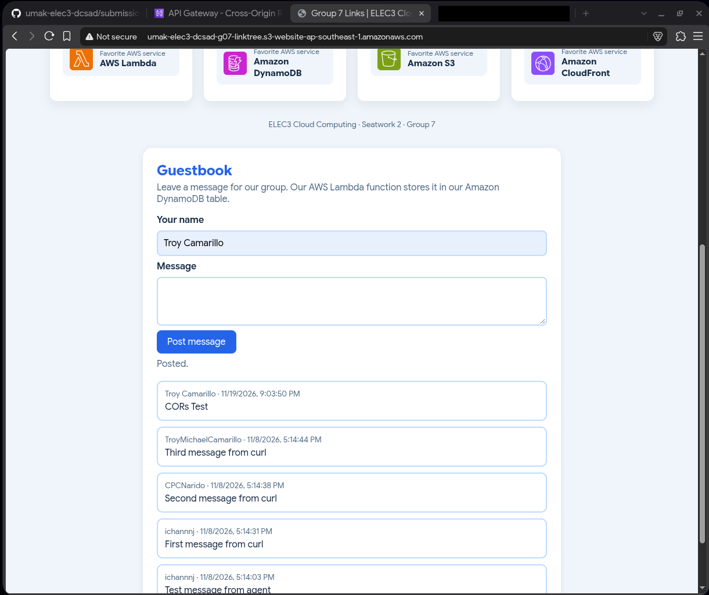
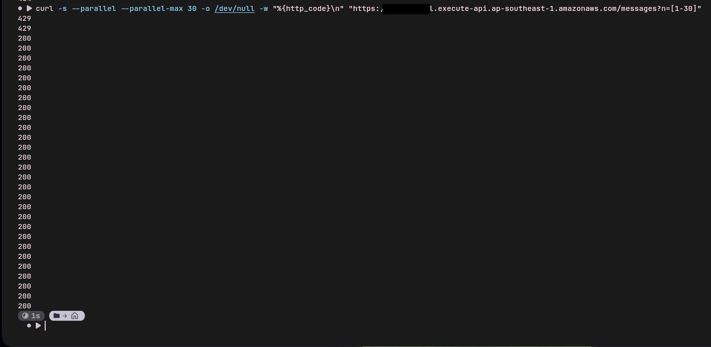

# Lab 5 Submission

<!--
How to use this template:

1. Copy this file to submissions/lab-5/group-<number>/submission.md
2. Replace every <answer> with your group's answer. Delete the angle brackets too.
3. Save cors-error.png, cors.png, site.png, and throttle.png in the same folder.
4. Crop the AWS console top bar out of cors.png, and cover every ARN.
5. Cover your API ID, the part between https:// and .execute-api, in cors-error.png, cors.png, and throttle.png.
6. Do not add your index.html. It holds your invoke URL.
7. Do not write full names or student numbers in this file.
-->

## About us

- Group number: 7
- Section: IV-DCSAD
- Group IAM user: dcsad-g07
- Website endpoint: http://umak-elec3-dcsad-g07-linktree.s3-website-ap-southeast-1.amazonaws.com
- HTTP API name: umak-elec3-dcsad-g07-api

## Screenshots

## Questions

1. In Lab 4, your API answered `curl` and the address bar of your browser. In Step 3, the same API did not answer your page. Why?

   curl and direct browser navigation do not enforce the browser's Same-Origin Policy (SOP). In Step 3, client-side JavaScript (fetch) was blocked by the browser because the API had not yet configured CORS headers to permit requests from the S3 website origin.

2. Which pillar of the AWS Well-Architected Framework does your throttle serve? Explain in two sentences.

   The throttle serves the Reliability pillar (as well as Cost Optimization). By limiting request rates and bursts, it protects downstream Lambda and DynamoDB resources from being overwhelmed by traffic spikes or denial-of-service attacks to keep the service operational. This boundary also prevents uncontrolled invocation spikes from running up unexpected AWS billing charges.

3. Your guestbook shows each message with `textContent`. What could a visitor do if the page put each message into the page as HTML with `innerHTML`?

   A visitor could perform a Stored Cross-Site Scripting (XSS) attack by submitting malicious HTML or <script> tags. When loaded via innerHTML, the browser would execute that script, allowing an attacker to steal visitor cookies/tokens, redirect users to phishing sites, or deface the page.
