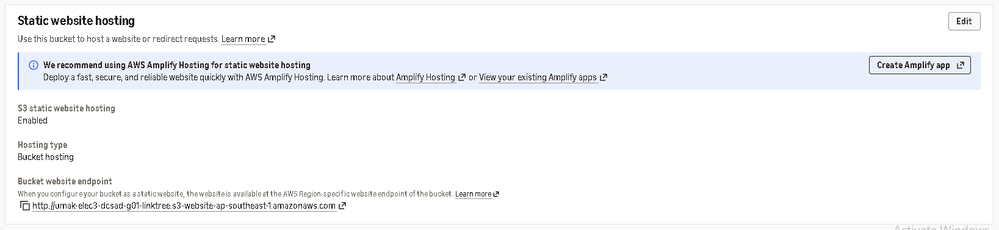
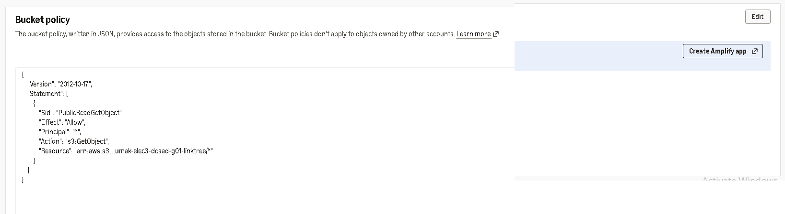
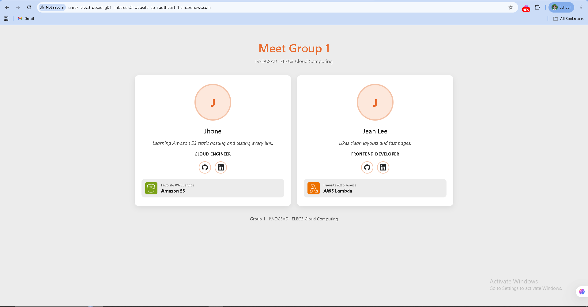

# Seatwork 3 Submission

## About us

- **Group number:** 1
- **Section:** IV-DCSAD
- **Group IAM user:** `dcsad-g01`
- **Bucket name:** `umak-elec3-dcsad-g01-linktree`
- **Website endpoint:** http://umak-elec3-dcsad-g01-linktree.s3-website-ap-southeast-1.amazonaws.com

## Screenshots

### Static website hosting with the endpoint

### Saved bucket policy

### Our page open in the browser

## Contribution

| GitHub username | What this groupmate did |
| --- | --- |
| jhonemarss | Configured the S3 website hosting, bucket policy, and public access settings; verified the website endpoint and prepared the submission screenshots and GitHub files. |
| jeanleee29 | Assisted in developing and customizing the Group 1 Linktree webpage, including the group member information, profile links, and page content for Seatwork 3. |

