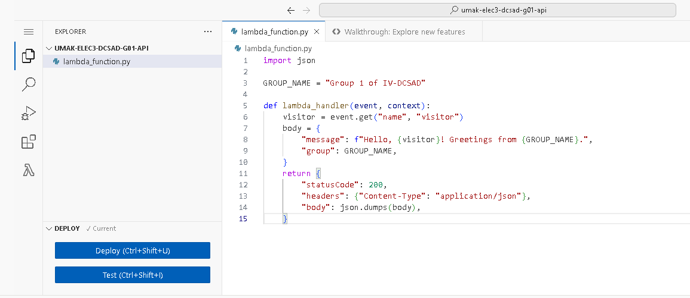
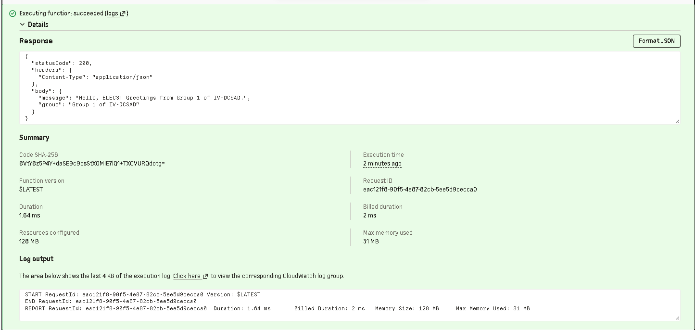
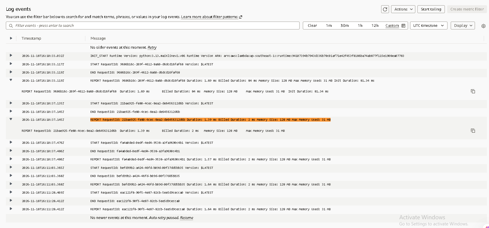

# Seatwork 4 Submission

## About Us

- **Group number:** Group 1
- **Section:** IV-DCSAD
- **Group IAM user:** `dcsad-g01`
- **Function name:** `umak-elec3-dcsad-g01-api`

## Handler Code

```python
import json

GROUP_NAME = "Group 1 of IV-DCSAD"

def lambda_handler(event, context):
    visitor = event.get("name", "visitor")
    body = {
        "message": f"Hello, {visitor}! Greetings from {GROUP_NAME}.",
        "group": GROUP_NAME,
    }
    return {
        "statusCode": 200,
        "headers": {"Content-Type": "application/json"},
        "body": json.dumps(body),
    }
```

## REPORT Lines

**First run – Cold Start:**

```text
REPORT RequestId: 9686b16c-209f-4612-8a60-d6dcd16faf68 Duration: 1.89 ms Billed Duration: 84 ms Memory Size: 128 MB Max Memory Used: 31 MB Init Duration: 81.34 ms
```

**Second run – Warm Start:**

```text
REPORT RequestId: 21bae925-fe80-4cec-8ea2-de6456312d6b Duration: 1.39 ms Billed Duration: 2 ms Memory Size: 128 MB Max Memory Used: 31 MB
```

## Question

**Why does the second REPORT line have no Init Duration?**

The second invocation was a warm start because AWS Lambda reused the execution environment that was initialized during the first invocation. The initialization phase only happens when Lambda creates a new execution environment. Since the environment was already initialized and reused for the second invocation, there was no additional initialization time to report, which is why the second REPORT line has no `Init Duration`.

## Screenshots

**Code tab with our deployed handler**



**Test result with "Executing function: succeeded"**



**The two REPORT lines in CloudWatch**



## Contribution

| GitHub username | What this groupmate did |
|---|---|
| Jhonemarss | Created and configured the AWS Lambda function, wrote and deployed the Python handler, executed test invocations, and documented the cold-start and warm-start REPORT logs. |
| Jeanleee29 | Assisted in reviewing the Lambda implementation and submission requirements, checking the test results and CloudWatch logs, and preparing the submission documentation and screenshots. |
| | |
